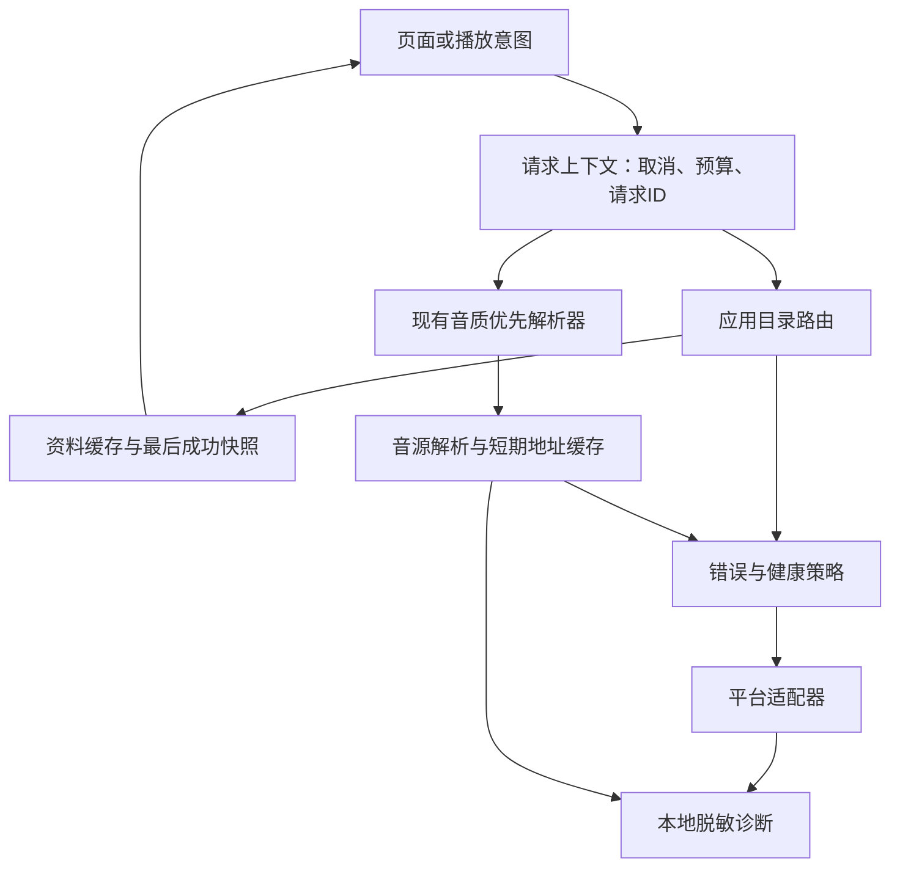

# JJ Music 在线资源可靠性开发设计

日期：2026-10-15。版本：1.0。状态：设计待评审，未实施。

目标：在线接口或音源故障时，保留仍可用的资料，让失败原因可定位、等待有上限、修复可交付；不以错误版本、虚假音质或静默改变来源换取表面成功。

上游：[产品与播放规则](../../PRODUCT_RULES.md)、[播放一致性规划](../plans/2026-10-07-playback-consistency.md)、[统一人工验收清单](../../development/2026-10-12-final-manual-acceptance.md)。本文件补充可靠性设计，不重启已完成的 A–C 工作，也不把未完成的真实试听标记为通过。

本文采用上一轮已认可的方向。新增数值、数据契约和交互细节是本版推荐设计，随本文一起评审；文档写成不表示这些新默认值已被用户逐项确认。评审通过后再编写逐步实现计划、选择执行方式。此次不修改产品代码，不提交或推送。

## 1. 范围与成功标准

包含：搜索与歌曲资料、歌单导入/刷新、歌词封面、短期播放地址、分能力健康状态、音源与目录适配器更新、脱敏诊断、样本测试与低频真实检查。

不包含：平台账号登录、突破访问限制、完整 JJ 插件协议、在线代理后端、远程执行目录适配器、音频离线缓存、自动下载歌曲、跨版本歌曲替换、新榜单/评论功能。

成功标准：

1. 刷新失败不清空上次成功资料，不删除收藏或已导入歌单。
2. 瞬时故障可以有限恢复，永久或结构错误不无限重复请求。
3. 故障只影响相应平台/能力/音源，不错误扩散到整个播放器。
4. 音源修复与应用目录修复有明确交付路径，更新失败可恢复。
5. 一次失败能够关联到具体阶段、资源类型和版本，并导出不含敏感内容的报告。
6. 模拟回归与真实服务验证分开报告，不承诺第三方永远可用。

## 2. 当前实现与需要补齐的内容

本节为 2026-10-15 定向静态核对，不代表本轮重新运行了产品测试。

| 范围 | 已有基础与入口 | 本轮增量 |
| --- | --- | --- |
| 统一在线解析 | `src/renderer/src/utils/online-resolver.ts` 已按档位遍历候选，提供 60 秒总预算、取消和原条目/实际资源分离 | 统一失败信息；与缓存、健康状态共享上下文 |
| 源请求与重试 | `src/main/sources/source-engine.ts` 已有严格档位和有界 429 重试；单次源上限见人工验收记录 | 结构化错误，避免新增层重复重试 |
| URL 缓存 | `src/renderer/src/stores/player.ts` 已有 5 分钟缓存、目标档命中限制及音源变更清理 | 有依据的有效期、失效原因、一次刷新链路 |
| 目录路由 | `src/main/online/search-router.ts`、`library-router.ts` 已分离应用目录与音源；聚合搜索可报告局部失败 | 缓存返回信封、错误归一化、增量显示和有界等待 |
| 热词 | `hot-words.ts` 已有按日持久化、在途合并和失败退避 | 复用实现，统一版本与缓存状态，不另建第二套调度 |
| 歌手/专辑 | `entity-details.ts` 有限定平台详情能力和短期专辑缓存 | 成功快照、过期展示与适配器版本键 |
| 本地歌词 | `src/main/library/lyric-service.ts` 已优先侧车与内嵌资料，跟踪本地文件版本并支持源缓存失效 | 保持本地优先，补齐在线缓存时间与来源状态 |
| 音源更新 | `source-updater.ts` 已提供检查、用户确认、稳定身份、更新失败恢复及回退 | 改善失败解释、版本事件与能力级验证 |
| 诊断 | `tools/diagnose-online.mjs` 区分合成源与真实源，但会查找用户实际音源配置 | 新增安全默认模式和受控真实验证入口 |

工作区还存在其他任务对播放器、曲库和回归测试的未提交修改，以及全局审查报告。实施前重新核实其状态，不能覆盖，也不能把报告中尚待复核的缺陷当成已经修好。

## 3. 固定约束

以下可靠性规则使用 OR-01 至 OR-12 标识，供任务与验收引用。

- OR-01：保留已确认的本地/在线独立、原歌曲身份、同版本匹配、目标音质优先和实际播放后收集规则。
- OR-02：一次刷新失败不覆盖最后成功值，不把异常写成空列表；缓存与保存的歌单/收藏分开存储。
- OR-03：错误分类决定重试、缓存和健康计数，不能只凭一个 HTTP 状态或原始报错猜测原因。
- OR-04：一次用户意图共享取消和总预算；重试只有一个负责人，不能在各层叠加。
- OR-05：只有符合策略、身份和版本约束的缓存可用；播放地址不得使用过期容错。
- OR-06：健康状态按具体能力分域，单曲缺失不代表平台或音源整体故障。
- OR-07：音源与目录更新分开，保留稳定身份及兼容读取；更新检查不静默执行新代码。
- OR-08：诊断默认本地、脱敏、有界；真实请求及真实脚本验证由用户显式触发。
- OR-09：搜索、刷新与播放的迟到结果不得覆盖新意图；消费者取消不能误杀其他有效消费者。
- OR-10：用户保存内容、手工歌词/封面、待写入资源不受自动缓存回收影响。
- OR-11：模拟通过、地址解析通过、媒体加载通过、真实听感通过分别记录。
- OR-12：分期交付，保留现有数据和关闭新增可靠性策略后的基础行为，不依赖新增云服务。

## 4. 架构与职责



首期使用现有 Electron 主进程、Vue/Pinia 和 TypeScript；不引入数据库、遥测服务或插件运行时。跨进程传递可序列化字段，`AbortSignal` 通过现有请求 ID 取消通道传播，不直接塞入 IPC。

建议新增文件按职责拆分，属于后续实现目标，不代表当前文件已存在：

| 建议文件 | 唯一职责 |
| --- | --- |
| `src/shared/online-reliability.ts` | 错误、状态、诊断事件和缓存信封的共享类型 |
| `src/main/online/reliability-policy.ts` | 错误分类、预算和重试判定，不做网络请求 |
| `src/main/online/resource-cache.ts` | 元数据/歌词缓存、最后成功值、原子持久化与合并请求 |
| `src/main/online/capability-health.ts` | 能力健康计数、冷却与半开探测令牌 |
| `src/main/online/online-diagnostics.ts` | 有界事件记录和脱敏导出 |
| `tools/probe-online-resources.mjs` | 显式、限定范围的真实资料探针 |

现有 `source-updater.ts`、`online-resolver.ts`、`lyric-service.ts` 与图片本地保存流程继续负责原业务。接入统一策略，不为共享缓存重写全部模块。图片二进制保存在既有本地资产目录，由缓存索引引用，不写进大 JSON。

## 5. 请求与错误契约

### 5.1 请求上下文

同一意图携带 `requestId`、`intentId`、`operation`、平台、能力、可选音源 ID/版本、单调时钟截止时间、取消句柄、尝试序号和重试所有者。主进程使用剩余预算，跨 IPC 不直接比较不同进程的单调时间戳。

页面意图和可共享网络操作分别拥有 ID：页面结束后只撤销自己的订阅；共享请求至少还有一名有效消费者时继续运行。最后一名消费者取消才中止底层请求。无消费者时不为了预热继续网络请求。

### 5.2 结构化错误

统一错误记录包含：`code`、`stage`、`platform`、`capability`、可选 `providerId/providerVersion`、`scope`、可选 `httpStatus/retryAfterMs`、面向用户的安全文案和内部关联 ID。

`scope` 区分资源、档位、能力、音源和客户端本地故障。字段缺失时保留 `unknown`，不强行分类。原始错误保留在受控内存中，跨 IPC 与导出前脱敏。

| code | 判定与建议动作 | 健康计数 |
| --- | --- | --- |
| `cancelled` | 新意图或用户取消；立即结束，不重试 | 不计 |
| `network` / `timeout` | 可识别的连接或阶段超时；剩余预算内最多重试一次 | 仅实际服务失败计入 |
| `rateLimited` | 可确认限流；遵守等待提示，不启动超预算重试 | 对相应服务设置等待，不混入网络失败 |
| `authRequired` / `forbidden` | 明确需要授权或访问被拒；提示原因，不猜测签名或绕过限制 | 不因单资源访问限制冷却全平台 |
| `notFound` | 已确认资源不存在；资源级短负缓存 | 不计平台故障 |
| `qualityUnavailable` | 指定候选无指定档位；继续该档其他候选 | 不计平台故障 |
| `unsupported` | 当前适配器/音源没有此能力 | 能力声明处理，不计故障 |
| `schemaChanged` | 必需字段或响应类型不符合契约；保留旧值，不原样重试 | 能力级计入 |
| `providerUnavailable` | 音源停用、崩溃或初始化失败；按已有绑定规则反馈 | 音源生命周期处理 |
| `urlExpired` | 有可靠过期信息或重新解析结果支持；清地址、重新解析一次 | 不据此判定平台故障 |
| `cacheIO` | 本地缓存读写错误；降为内存并提示可诊断 | 不计上游故障 |
| `unknown` | 信息不足；反馈安全摘要，不默认重试 | 不据此冷却整个平台 |

HTTP 403 也可能是访问拒绝，404 也可能是端点变化，HTTP 200 也可能返回错误页。分类需结合能力与响应契约；不能统一处理成 URL 过期或歌曲下架。

### 5.3 重试与预算推荐值

| 操作 | 总预算 | 单次上限 | 自动重试 |
| --- | --- | --- | --- |
| 播放解析 | 保留现有 60 秒 | 保留现有源请求 20 秒上限 | 复用已有约束，不额外叠加整链重试 |
| 搜索、资料详情、热词 | 12 秒 | 6 秒 | 瞬时失败最多一次 |
| 歌词、封面 | 10 秒 | 5 秒 | 瞬时失败最多一次 |
| 歌单完整读取 | 60 秒 | 每次分页请求 12 秒 | 每页瞬时失败最多一次，共享总预算 |

退避初始范围 250–750 ms，加入随机扰动；实际等待和单次超时均不超过剩余预算。`Retry-After` 优先，超预算则立即报告稍后重试。预算不足以完成有意义请求时不再尝试。取消、结构变化、明确无资源不重试。

现有源引擎若负责某次 429 重试，上层只看结果，不能再包一轮相同重试。播放器现有一次意图恢复也须复用原截止时间。新增策略不得改变“不自动跳过失败条目”的现有规则。

## 6. 缓存、持久化与刷新

### 6.1 返回信封与缓存身份

资料路由返回 `data`、`cacheState: fresh|stale|miss`、`fetchedAt`、`expiresAt`、`staleUntil`、`servedBy`、`partial` 和可选结构化错误。聚合返回各平台状态。首次无成功值且请求失败时返回失败，不伪造成功的空结果。

缓存键包含能力、平台、原生资源 ID 或规范化查询/页码、语言、适配器修订版本、缓存 schema 版本。源生成的资料另外包含稳定音源 ID 和脚本内容版本；目录缓存不因无关音源停用全部失效。

只存解析且校验通过的规范化数据。合法空搜索可正常缓存；异常、取消、半页结果和权限失败不能覆盖完整成功值。过期但在容错期内的值仅可用于展示，明确时间和刷新状态。

### 6.2 缓存策略推荐值

以下“最长展示期”从上次成功获取起算，不是在新鲜期之外再累加。源站明确禁止缓存、用户权限变化或内容被确认为撤回时，禁止继续按通用容错展示。

| 数据 | 新鲜期 | 最长展示期 | 持久化与刷新 |
| --- | --- | --- | --- |
| 搜索结果 | 5 分钟 | 30 分钟 | 内存，最多 200 个查询页，不持久化用户搜索词 |
| 热词 | 24 小时 | 7 天 | 复用现有持久化；从按日语义迁移需专门回归 |
| 歌曲基础资料 | 24 小时 | 30 天 | 规范化资料缓存；不据此保证仍可播放 |
| 艺术家/专辑详情 | 1 小时 | 7 天 | 保存上次完整成功快照 |
| 远程歌单缓存 | 30 分钟 | 30 天 | 与用户导入列表分离；手动刷新完整成功后展示差异 |
| 在线歌词与封面 | 30 天 | 180 天 | 校验内容后缓存；源版本与本地文件变化失效优先 |
| 播放地址 | 至多 5 分钟，或可信到期时间提前 30 秒，两者取短 | 不允许过期展示或使用 | 仅内存，命中仍服从音质和源版本约束 |
| 已导入歌单/收藏/手工资源 | 不适用 | 不自动过期 | 用户数据，不属于自动缓存 |

只有可信的资源不存在结果可做 30 秒负缓存，键仍包含平台、资源与版本；不把超时、未知错误、鉴权失败或字段变化缓存成“不存在”。确认支持的档位声明可直接排除不支持档位，不另造跨平台“整首无音质”缓存。负缓存不删除用户条目。

日期用于展示，内部新鲜度需处理系统时钟回拨：无法确定时间的记录按不新鲜读取，不能因此清空用户数据或无限有效。未说明失效语义的 URL 查询参数不能作为可信到期时间。

### 6.3 刷新语义与并发

普通打开：先返回可用缓存；不新鲜时仅在该页面/操作仍有效、未冷却且允许网络时刷新。无缓存则加载网络。手动刷新跳过新鲜度读取，但不突破访问限制、大小上限、取消和等待预算。

同键请求合并；每个消费者独立取消。每个键有写入代次，旧刷新晚于新刷新、缓存清理或版本切换返回时不得写回。缓存成功落盘失败保留内存结果，不回滚成空数据。

“更新失败”时保留 `data + stale + error`；不清空页面。超过展示期不再把缓存当当前结果，可显示“上次保存记录”，不得伪装为新请求结果。明确不存在或访问权限变更时隐藏相应远程缓存，用户保存条目仍保留不可用状态。

### 6.4 用户歌单与本地资料

歌单导入生成本地保存列表，之后不会因远程错误、空页、部分分页或远程删除自动清空。刷新先拉取完整候选快照，校验分页完整性，再展示新增/移除/顺序变化，用户明确应用；不静默覆盖本地编辑。

远程成功返回的合法空歌单也只形成差异预览，不能自动删除用户内容。中途页失败允许显示“未完整获取”，但不作为完整刷新提交。

本地歌词/封面仍先读当前本地内容。自动刷新不能修改标签、侧车文件或已确认的资源选择；用户已确认写入内容属于用户文件。待写入资源保持独立存储，不能被 LRU 回收。

### 6.5 地址失效处理

URL 只标识一次解析资源，收藏不保存它作为永久地址。媒体加载失败先区分网络、格式、地址与取消；可判断失效时清除该缓存，并在原意图共享预算内重新解析一次。仍失败则按现有严格音质、同版本和来源约束处理，不能先降档或改播本地。

已降档成功的缓存不能使下一次播放跳过目标档。停用/更新/删除音源时按源版本失效，在途结果不能重新填入旧版本缓存。

### 6.6 存储和迁移

新缓存放在应用资料目录的 `cache/online/v1/`，不写入源码目录。元数据/歌词使用现有原子 JSON 写入能力，按能力分桶和串行提交；图片沿用既有文件存储。首版不引入数据库。

推荐上限：元数据 48 MiB、歌词 16 MiB、封面 192 MiB，总计 256 MiB；搜索内存页另限 200 条。单条规范化元数据不超过 2 MiB，单张封面不超过 8 MiB，所有网络读取仍沿用现有有界抓取。分页完整结果超限时报告受限，不静默截断为完整歌单。

达到上限按最后访问淘汰普通缓存；不遍历删除用户歌单、下载文件、手工封面或待写入资源。图片如与用户资产共用字节，先解除缓存引用，确认无用户引用再回收。

缓存损坏/不兼容可丢弃该缓存桶并重新获取，不能丢弃关联用户列表。旧缓存只有来源/版本可验证且结构兼容才迁移；否则首次请求重建，保留旧用户数据。不因读取失败启用网络或执行脚本。

## 7. 分能力健康状态

健康键：目录为“平台 + 能力 + 适配器修订”；音源为“稳定音源 ID + 脚本版本 + 平台 + 能力”。歌曲或档位缺失只影响资源级结果，不影响整个平台。

状态：`healthy → cooling → halfOpen → healthy/cooling`。推荐在 5 分钟窗口内连续 3 次可计数服务失败后冷却 60 秒；半开失败延长到 120 秒，再到最多 300 秒。真实成功重置失败计数。缓存命中不证明上游恢复，取消/本地错误不计失败。

半开只在下一次有效用户请求到达时允许一个探测，其他请求读取可用缓存或得到可解释状态，不后台定时扫描全部平台。429 按服务端等待期处理，不能用频繁“手动重试”绕过限流。

手动重试可跳过普通故障冷却，每个健康键至多每 30 秒一次；不绕过 429 等待或用户停用。健康状态只存内存，重启后恢复未知/可尝试，不永久封禁。内容不可用、缓存过期、源脚本崩溃必须分别显示。

同一档位中可先尝试健康候选；冷却候选要记录跳过原因。不把健康排序当作提前降低音质的依据；冷却并不证明该候选永久不可用。

## 8. 更新与修复交付

### 8.1 LX 音源

复用已有每日检查、手动确认、稳定身份、候选启动及更新失败恢复。检查版本只读取数据，不执行候选；停用源更新后保持停用。保留现有摘要/风险说明，SHA-256 不能被描述成发布者签名。

更新开始时停止旧代次的新请求，成功后广播版本变更，失效旧源地址、健康状态和源生成缓存。失败恢复旧版后仍不能接收更新前在途结果；重新获取需要的资源。目录缓存独立保留。

自动候选启动成功只证明初始化，不证明所有平台可播。对更新结果分别显示“已安装/初始化通过”和“实际播放未验证”。真实验证由用户明确选定歌曲/平台后进行。回退按既有确认流程执行，不能静默切换到未知脚本。

### 8.2 应用目录适配器

首版继续随应用版本交付，不新增远程目录代码包。为适配器引入独立 `adapterRevision` 与契约样本；发布说明指出修复的平台和能力。配置热更新也不纳入首版，避免以配置名义执行表达式或任意代码。

修复流程：脱敏失败报告 → 样本回归失败 → 修改指定适配器 → 离线回归与受控真实检查 → 应用版本交付 → 用户更新后确认能力恢复。

适配器修订后不能把旧结果标为新版本成功。兼容的旧规范化资料可作为明确标记的最后保存记录保留；新鲜缓存须由新修订成功产生。schema 不兼容则只保留用户保存的条目，不读取旧缓存为当前数据。

完整独立适配器包只在后续维护成本确有需要时单独立项，届时设计发布者验证、宿主兼容、回退和版本事件。

## 9. 诊断、真实检查与 UI

诊断默认仅本地保存最近 500 个事件，持久化环形日志上限 2 MiB；用户可清除和关闭详细诊断。常规安全计数不需要上传，首版不接遥测服务。

事件记录请求/意图关联 ID、平台、能力、适配器或音源版本、阶段、耗时、缓存状态、错误码、尝试次数和是否取消。默认不记录搜索词、歌名、歌词、完整本地路径、脚本正文、平台私有参数、HTTP 请求头、URL 路径或查询参数。

HTTP 状态码可记录；远程地址仅保留归一化主机名，不含端口之外的路径/凭据。导出前再次按字段白名单序列化，不能仅靠对原始报错做字符串替换。对原始错误只提供受控摘要和关联 ID，不把可能带 token 的 message 原样导出。

报告分“引擎初始化/合成协议”“目录资料”“地址解析”“媒体加载”“人工听感”五类。合成地址成功不表示存在可播放音频，更不能用于宣称真实平台已恢复。

现有 `npm run diagnose` 会读取实际配置并可能运行真实音源。改造后默认只用临时资料和合成源；只有显式 `--live` 且指定测试配置/源与平台才运行真实脚本。新增资料探针默认不联网，真实模式显式启用，并限制并发为 1、每平台每能力最多一个样本、整体 60 秒。

不在启动时自动全平台探测；首版不加入定时联网 CI。用户触发真实检查后仍允许取消，测试脚本不持久修改用户配置或故意制造限流。

UI 只在有助于判断时显示“正在加载缓存/资料较旧/部分平台失败/暂时冷却/地址重新解析”等简短信息。歌曲身份、实际平台和解析档位沿用现有展示；详细技术信息放诊断页，不堆进点歌流程。

## 10. 分期任务与开发入口

下面是设计层任务范围，不替代评审后逐步实现计划。每项应独立形成有意义的测试和交接记录。默认顺序 OR0 → OR1 → OR2 → OR3 → OR4 → OR5 → OR6 → OR7 → OR8；不同时改写同一播放流程。

| 任务 | 范围与主要文件 | 交付及门槛 |
| --- | --- | --- |
| OR0 基线 | 当前源码、用户修改、已有审查与人工清单、真实测试 runner | 核实未提交并发修复与已知失败；记录已有能力，隔离工作区；不重复做 A–C |
| OR1 错误与诊断 | 新共享类型/策略/诊断模块；现有路由与 IPC | 结构化错误、白名单导出和预算归属；先能定位最常失败的能力 |
| OR2 搜索与资料缓存 | 新缓存模块；`search-router.ts`、`entity-details.ts`、`hot-words.ts`、测试构建入口 | 先接作者常用的两个平台；刷新失败保留旧值，单请求合并、取消、容量和版本通过 |
| OR3 歌词与封面缓存 | `lyric-service.ts`、`cover-fetch.ts`、既有本地资产服务 | 本地优先、内容校验、失效、缓存回收与用户资产隔离 |
| OR4 歌单快照刷新 | `library-router.ts`、`playlist-import.ts`、保存列表服务及导入/刷新 UI | 完整候选快照与差异确认；分页失败、合法空歌单不清空已保存内容 |
| OR5 健康与播放接入 | 新健康模块；`online-resolver.ts`、`source-engine.ts`、播放器 store | 能力冷却、同档候选、URL 一次刷新；共享预算、取消和绑定不回归 |
| OR6 更新版本衔接 | `source-updater.ts`、源版本事件、目录修订信息与缓存 | 更新/回退失效和状态反馈；不新增远程目录热更新 |
| OR7 样本与真实检查 | `src/test/`、`tools/build-test.mjs`、`tools/diagnose-online.mjs`、新资料探针 | 默认无真实脚本与网络；显式真实模式、脱敏报告和分级结果 |
| OR8 集成与人工验收 | 现有规则回归、真实平台样本、独立验收记录 | 所有 RR 场景通过且限制如实记录，作者确认日常操作；再扩展其他平台 |

首批平台在 OR0 根据作者实际使用记录选定；没有记录时由作者选择两家。数据契约与错误类型覆盖所有已有平台，不能为只接两家而移除其余现有功能。网络故障仅影响未通过真实验证的状态，不阻止离线回归。

OR0 若发现已有队列重试或扫描删除并发缺陷仍未修复，应先由对应修复任务完成并验证，或明确隔离受影响范围后再接入可靠性策略。新增缓存和重试不得掩盖这些缺陷，也不得把其他任务未提交的修复混入本专项交付。

建议测试文件：`online-reliability-policy.test.mts`、`online-resource-cache.test.mts`、`online-capability-health.test.mts`、`online-diagnostics.test.mts`；同时扩展现有 `search-router.test.mts`、`library-router.test.mts`、`hot-words.test.mts`、`entity-details.test.mts`、`local-lyric-cache.test.mts`、`online-resolver.test.mts`、`source-updater.test.mts`。新增生产模块须加入现有测试打包入口。

每项交接记录放 `docs/development/2026-10-15-online-reliability/<任务编号>.md`，注明规则、决定、文件、实际检查、样本来源/版本、真实验证状态和遗留问题。文件夹由实施时创建。

## 11. 验收矩阵

| 场景 | 操作/故障 | 预期 | 规则 | 任务 |
| --- | --- | --- | --- | --- |
| RR01 | 有旧成功值，刷新超时/结构变化 | 保留旧数据、时间与错误，不变空列表 | OR-02、OR-03 | OR1、OR2 |
| RR02 | 首次请求失败/合法空搜索 | 前者为失败，后者为成功空结果，缓存语义不同 | OR-02 | OR2 |
| RR03 | 刷新歌单中间页失败或远程合法空单 | 不自动清空/覆盖本地列表；完整结果才形成差异预览 | OR-02、OR-10 | OR4 |
| RR04 | 连续网络失败/单曲404/档位缺失 | 仅正确能力冷却；后两者不冷却整个平台 | OR-03、OR-06 | OR1、OR5 |
| RR05 | 429等待超过预算，或两层均有重试 | 及时结束，无重试相乘，不越过共享截止时间 | OR-04 | OR1、OR5 |
| RR06 | 两消费者共享请求，取消一个再取消最后一个 | 首次取消不影响剩余者，最后取消终止底层 | OR-09 | OR2 |
| RR07 | 新刷新/源更新后旧请求返回 | 不覆写新状态，不重新填入失效缓存 | OR-05、OR-09 | OR2、OR6 |
| RR08 | 缓存损坏、写入失败、达到上限 | 可降内存或重建缓存；用户列表/待写入资源不丢失 | OR-10、OR-12 | OR2、OR3 |
| RR09 | 地址过期/普通403/低档缓存命中 | 正确区分原因；刷新有上限，目标档优先不回归 | OR-01、OR-03、OR-05 | OR5 |
| RR10 | 只歌词失败、缓存命中或用户取消 | 不关闭搜索/音频，后两者不算上游恢复/失败 | OR-06 | OR3、OR5 |
| RR11 | 半开并发访问、手动重复重试 | 仅一个探测；保持限流与冷却策略，无后台风暴 | OR-04、OR-06 | OR5 |
| RR12 | 源更新失败/停用源更新/回退 | 恢复可解释状态，身份不变，停用不执行，版本事件正确 | OR-07 | OR6 |
| RR13 | 目录适配器修订或schema变化 | 旧值不冒充新版本成功，不影响用户已保存条目 | OR-05、OR-07 | OR2、OR6 |
| RR14 | 原始错误含token、搜索词或路径 | 导出只含白名单字段，敏感原文不可检索到 | OR-08 | OR1、OR7 |
| RR15 | 默认诊断及显式真实检查 | 默认不读取/执行实际源、不联网；真实结果分级 | OR-08、OR-11 | OR7 |
| RR16 | 本地歌词变化、已有手工封面、清缓存 | 本地优先，手工和待写入内容保留，不改标签 | OR-01、OR-10 | OR3 |
| RR17 | 系统时钟回拨、缓存时间缺失 | 不无限延长新鲜度，不清用户数据 | OR-05、OR-12 | OR2 |
| RR18 | 模拟成功但真实平台失败 | 分别记录，不能宣称真实播放或听感已通过 | OR-11 | OR7、OR8 |
| RR19 | 换源、取消、混合收藏和快速切歌 | 原条目身份不变，本地在线独立，不提前收集/错播 | OR-01、OR-09 | OR5、OR8 |
| RR20 | 关闭诊断、清缓存及撤销新增健康策略 | 基础播放与用户数据保留，不依赖外部服务 | OR-08、OR-12 | OR1、OR8 |

测试注入时钟、随机数、fetch、存储和源响应，不靠真实等待耗尽 60 秒。样本至少含标准结果、合法空值、分页失败、HTTP 200错误页、字段变化、限流、鉴权与敏感错误。

## 12. 检查命令、交付与后续动作

当前 `package.json` 已核实存在：

```powershell
npm run typecheck
npm run test
npm run check:gate
npm run build
npm run verify
npm run test:e2e
```

`npm run verify` 已包含类型、构建、测试和 gate；阶段验收运行一次即可，不机械重复前四项。局部开发可以运行对应检查。现有 runner 会构建 `out/test` 并复制套件，不支持未经实现的 `--filter`；不要直接运行依赖编译模块的源 `.mts` 来冒充生产回归。

`npm run test:online` 当前只选择实时歌词相关套件，不代表搜索、歌单、播放全覆盖。`npm run diagnose` 当前可能运行真实脚本，在 OR7 改造前不要把它纳入无人值守常规检查。Electron E2E 与写入相关验收使用独立复制资料目录。

本轮只交付文档。实施交付需有 RR01–RR20 记录、相关自动检查及必要真实验证，保留未通过项；缺少网络或未获真实脚本使用授权时标记未验证，不阻塞无关离线任务，也不假装通过。

建议下一步：评审本文件的缓存期限、容量、冷却、重试和歌单刷新交互；确认首批两个平台。评审通过后，以 OR0–OR2 为第一份具体实现计划，再逐期补齐后续工作，不一次性改写全部在线模块。

## 13. 参考与适用边界

- [LX 自定义源协议](https://lxmusic.toside.cn/desktop/custom-source)：脚本能力和更新通知。应用目录适配器仍由 JJ 维护，不能承诺音源更新修好目录接口。
- [RFC 5861：过期缓存容错](https://www.rfc-editor.org/info/rfc5861/)：缓存容错思路。本文是应用缓存策略，不表示忽略源站缓存控制或访问约束。
- [AWS：超时、重试、退避与随机扰动](https://aws.amazon.com/builders-library/timeouts-retries-and-backoff-with-jitter/)：有限重试与避免多层放大。本文参数为项目推荐值，不是照搬外部服务的保证。
