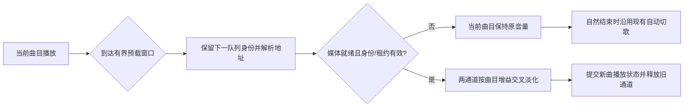

# JJ-Music 交叉渐变设计草案

状态：用户已批准（2026-10-26）；尚未编写产品代码
日期：2026-10-26

## 意图

让歌单自动切换时，前后两首歌在短时间内同时播放并交叉调整音量，减少曲目之间的空白。用户已确认需要两首歌短暂重叠；双通道如何接入现有音频图、参数默认值和具体队列边界由本草案提出，仍以用户批准为准。

## 当前实现

- `player.ts` 的 `playTrackAt` 每次只加载一个曲目；手动切歌会先做最多 300 ms 的短淡出，然后停止旧曲目、解析新地址并加载新曲目。
- 自动切歌依靠 `ended` 事件。`handleEnded` 根据播放模式选择下一项；当前歌曲结束后才开始加载下一首。
- `WebAudioEngine` 只有一个 `HTMLAudioElement`，并在首次播放时创建一条 Web Audio 图。已有增益自动化用于暂停、恢复和短切歌过渡。
- 设置 `shortAudioTransitions` 默认开启，只控制短暂停/恢复和手动切歌过渡。旧播放规划明确不含两首音频重叠；本功能是独立的新范围，不改写旧规划的历史记录。

## 用户已确认

- 交叉渐变需要两首歌短暂重叠。
- 新曲第一次进入播放时即切换当前曲目；若新曲在淡化完成前失败，恢复前曲的实时位置及界面状态。
- 淡化开始后的 seek 保留新曲并立即结束前曲；淡化开始前的 seek 取消预载并继续当前曲。

除此之外的参数和实现路线均为本草案提议，尚未由用户确认。

## 目标

1. 支持相邻曲目的短暂重叠与平滑音量交接。
2. 复用现有 URL 解析、音质选择、播放代次、队列身份、音量、静音和均衡器行为。
3. 只提前准备一个即将播放的曲目；队列或用户意图改变后，迅速取消并释放过期准备。
4. 下一曲无法及时准备时，让当前曲目按原行为正常结束；不得为等待网络而暂停、延长或突然压低当前曲目。
5. 让用户能关闭交叉渐变或调整时长，且升级后不改变既有用户的播放习惯。

## 非目标

- 不承诺无缝或采样级 gapless、无损/bit-perfect 输出、DJ 混音、节拍同步、自动响度匹配或人工听感验收。
- v1 不为手动上一首、下一首或直接点选曲目加入长交叉渐变；这些操作保留当前短过渡与即时响应。
- 不修改在线音源协议、曲库资料格式、收藏规则或播放列表内容。
- 不改造未来的 WASAPI/原生引擎；不支持交叉渐变的引擎继续使用既有的曲目结束流程。

## 设计路线

| 路线 | 取舍 | 结论 |
| --- | --- | --- |
| 单媒体元素依次淡出、切换、淡入 | 改动最小，但没有两首歌同时播放；不满足用户选定的体验。 | 排除 |
| 在同一个 `WebAudioEngine` / `AudioContext` 中维护两个媒体元素通道，并在共享输出图中混音 | 可以保留流式播放、同一套音量/静音/均衡器和分析器；需要扩展音频引擎与播放器状态，正确处理预加载、取消和交接。 | 推荐 |
| 每首歌完整解码为 `AudioBuffer` 后混音 | 便于精确排程，但长曲目占用较多内存；在线跨域流、Range 请求和大文件解码不适合此路径。 | 排除 |

选择双通道的根据是用户明确要求实际重叠；共享音频上下文避免复制输出设备、均衡器和分析器状态。把两条完整引擎放进 Player Store 会复制上下文及事件所有权，难以保证设置与状态一致。

## 提议的行为

### 偏好设置

- 新增独立设置 `crossfadeDurationMs`，建议提供 0–12 秒、1 秒步进的设置控件；0 秒表示关闭。
- 建议默认值为 0 秒，升级现有设置时也填 0。交叉渐变是新的听感行为，默认关闭可保留现有播放结果；用户可主动开启。
- `shortAudioTransitions` 保持独立，继续控制原有短暂停/恢复和手动切歌淡化。关闭短过渡不应关闭已启用的自动交叉渐变，反之亦然。
- 播放中把时长改为 0 时，立即完成正在进行的交接并释放旧通道，避免音频突然消失；改为其他非零值只影响后续交接。

上述范围和默认值是设计建议，不是用户已确认的参数。

### 适用的播放场景

- 只对自然结束后的自动下一首生效；手动切歌维持当前 300 ms 短过渡。
- 播放模式 `list` 到达队尾时停止，不跨到首曲；`repeat` 与 `random` 可准备下一项。随机模式必须只抽取一次，并复用已保留的目标，不能在交接和 `ended` 回退时再抽一次。
- `single` 单曲循环、单曲试听、队列不足两项、下一项与当前项是同一队列身份、时长未知或不足以形成至少 1 秒的重叠时，不启用交叉渐变，沿用原有结束处理。
- 当前曲目暂停时不开始交接；恢复后按新的播放位置继续判断。

### 准备和交接

1. 当前曲目接近尾声时，播放器按当前播放模式保留唯一的下一项身份，并开始有界的地址解析和媒体预加载。预载不改变 `currentIndex`、播放历史、收藏、歌词或当前曲目的错误状态。
2. 只有当下一首已经取得可用播放地址、媒体已进入可播放状态、队列身份与播放代次仍有效、地址租约可覆盖交接启动时，才可以启动淡化。实现应复用已有解析超时与 `playbackUrlLease` 校验；不得长时间缓存过期的音源播放地址。
3. 当剩余时长进入设定的交叉渐变窗口后，启动两条独立的曲目增益曲线。建议使用等功率曲线，主音量与静音增益放在混合之后，调音量不应覆盖曲目交接自动化。
4. 新曲首次触发有效 `playing` 事件、开始淡入时，播放器状态切换到新曲：`currentTrack`、进度、歌词和媒体按键都指向新曲。该次播放只记录一次。旧曲在渐变完成后停止并释放媒体资源。
5. 实际交接时长取设定值与两首曲目可播放时长的较小值；若有效时长小于 1 秒，则跳过交叉渐变。此规则避免很短的片段被大部分遮盖。

预载窗口应服从现有播放解析预算和地址租约：在预计交接前尽早开始解析，但只有地址租约覆盖交接启动的地址才可用于播放。如果预载尚未就绪，不降低当前曲目音量；自然结束时交回现有 `handleEnded` 路径。

### 用户操作、队列变化与失败

- 播放器对当前曲目、队列、播放模式、随机历史和地址解析代次建立交接令牌。点击另一首歌、下一首/上一首、停止、清空队列或切换来源时，立即使预载令牌失效并取消其网络请求。
- 调整队列顺序或删除已保留的下一项时，取消旧预载并依据新队列重新确定目标；不可播放已删除项或把旧队列位置当作当前项。
- 新曲已触发有效 `playing` 事件后，普通队列重排只影响后续选择，不撤销当前交接；删除当前曲目则按现有删除当前播放条目的规则处理。交接提交前移除目标曲目时必须取消预载并重新选择。
- 暂停时同时暂停两通道，保存两条曲目增益与交接剩余时间；恢复后从暂停位置继续曲线。停止或播放器销毁时清除两条通道、事件监听器、计时器和媒体请求。
- 淡化开始前 seek 取消下一曲预载并只 seek 当前曲目；淡化开始后 seek 立即结束交接、释放旧曲并只 seek 已提交的新曲。
- 下一曲在预载阶段解析失败时，当前曲目继续正常播放，不弹出覆盖当前播放的错误；到自然结束时走既有自动切歌/错误处理。
- 新曲在交接完成前播放失败而旧曲仍可播放时，恢复旧曲的实时位置、增益、`currentIndex`、当前曲目身份、进度、歌词及媒体按键归属。**设计者建议**：已经实际进入播放的新曲记录保留，因为用户已听到它；不要让新曲的错误处理器一边让旧曲继续出声、一边启动新一轮恢复。旧曲自然结束时交回现有自动切歌与错误恢复逻辑。旧曲已不可恢复而新曲可播放时完成交接。任何迟到事件都必须通过通道身份和交接代次校验。
- 旧曲通道收到预期的 `ended` 不应再次触发队列跳转；仅当前有效通道可驱动自然结束处理。
- 两条曲目通道共享主音量、静音、均衡器及频谱分析器；每条有独立曲目增益。v1 建议用等功率曲线，接受极端同相峰值可能短时升高的风险；如验证发现实际削波，需要在实施计划中决定限幅策略，不能静默改变全局响度。

## 兼容与资源约束

- 保持 Player Store 不直接依赖 Web Audio API：在 `AudioEngine` 中定义可选的预载/交接能力和能力标记；不支持该能力的引擎走旧路径。
- 每个媒体元素只建立一次 `MediaElementAudioSourceNode`。每条通道有独立加载代次与错误/结束事件身份；所有曲目经同一均衡器、主音量与 analyser 输出。
- 预载最多占用一个额外通道；准备失败、取消、队列变化、交接完成和引擎销毁都会清除元素 `src`、取消请求并释放音频节点。
- 在线地址须重新校验租约，地址过期就重新解析；不得为了无缝过渡重放已过期 URL。解析未完成时优先保留现有播放状态与原结束处理。

## 验收标准

1. 双音轨合成夹具能验证交接期间两通道同时发声，淡化开始、交接提交和旧通道释放顺序正确；0 秒关闭时无重叠。
2. 确定性测试覆盖 `list` 队尾、循环、随机保留项、单曲循环、单曲试听、重复身份、短曲、未知时长、预载超时和预载失败。
3. 在预载、淡化前后分别取消或改动队列，旧请求和旧事件不得改变当前轨、播放历史、歌词、收藏或用户操作结果；随机序列不得重复抽取。
4. 暂停、恢复、seek、手动下一首/上一首、直接选曲、停止、音源切换与应用销毁均能取消或延续正确的双通道状态，不留下媒体请求、监听器或计时器。
5. 本地曲目与在线曲目均使用合成/隔离媒体夹具验证；外部网络请求为零，在线 URL 过期时不会使用旧地址。
6. 设置从旧数据升级后默认为 0；切换设置不影响既有 `shortAudioTransitions` 行为。
7. 通过项目离线验证套件和生产构建；真实平台、安装升级与人工听感分别记录，不以合成测试代替。

## 实施时待 Builder 决定的细节

- 将“可播放”定义为 `canplay`、指定缓冲时长或一次成功播放的哪个门槛；推荐以 `canplay` 为基础并实际观察首帧启动。
- 音频图节点的创建、两个媒体元素的生命周期，以及曲目事件进入 Player Store 的最小接口。
- 对当前曲目的主动删除继续遵循已有队列删除语义；实施时需确认它与交接后的双通道清理没有竞争。
- 真实媒体端点对 `preload="auto"` 的 Range 请求与地址租约表现，需要以本地合成探针和受控假服务验证；在线脚本与真实平台不纳入无人值守自动测试。

## 交付边界

本文档只记录设计，不实现播放行为，也不表示交叉渐变已开发。用户批准本设计后，再编写分步实施计划；计划需先覆盖音频引擎双通道、队列预载/交接状态机、设置迁移和合成生命周期验收。
