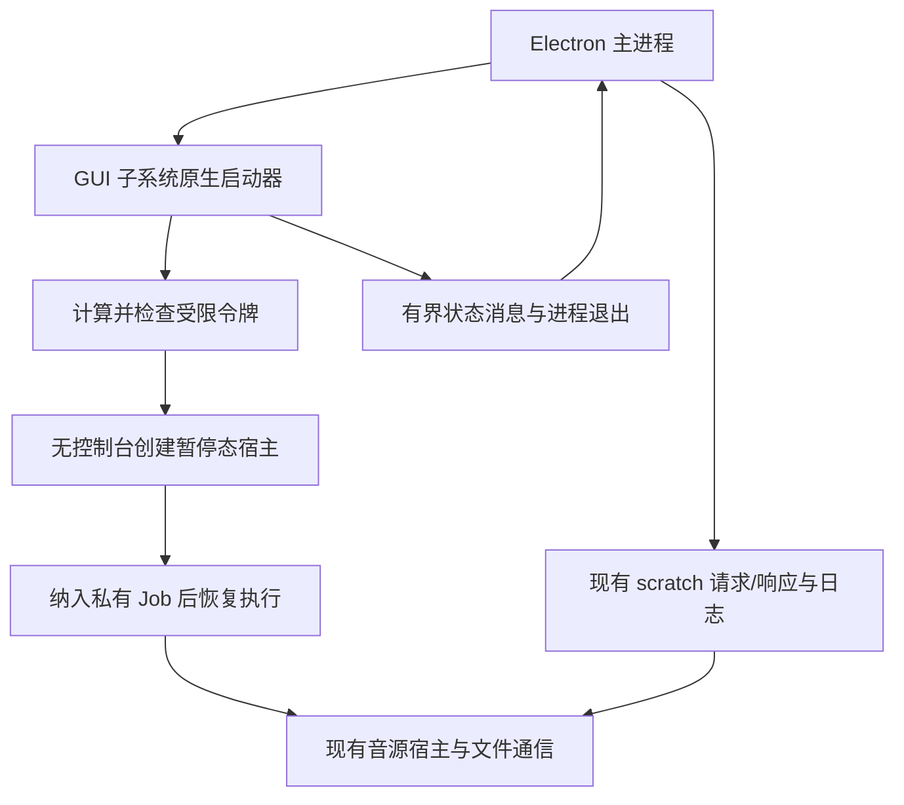

# Windows 音源无窗口启动器改造设计

日期：2026-10-28。版本：1.0。状态：用户已要求继续开发；WL1 原生验证及 WL2 宿主接入已实施，构建资源已接入，完整验收仍进行中。执行进度见 [WL2 记录](../../development/2026-10-28-windowless-source-launcher/WL2.md)。

目标：应用启动、启停音源、更新与崩溃恢复期间，不创建或闪现音源启动链路的终端窗口，不抢焦点，同时保留受限权限、独立进程和可靠回收。

依据：[产品与播放规则](../../PRODUCT_RULES.md)、[当前架构说明](../../ARCHITECTURE.md)、用户提供的 Windows Terminal 黑窗口截图。本文是修改方案和开发分解，不表示原生辅助程序、构建或验收已经完成。评审通过后再形成逐步实现计划。

## 1. 已核实事实与诊断边界

1. `src/main/sources/restricted-launch.ts` 的现有 Windows 链路为 `runas /trustlevel:0x20000 → launch.cmd → cscript launch.vbs → Electron/Node 音源宿主`。
2. 外层 `spawn` 已有 `windowsHide: true`，VBS 也以窗口模式 0 启动宿主；中间 CMD 仍属于控制台程序。源码注释已经承认该环节可能创建可见窗口。
3. `source-runtime-host.ts` 在 Windows 自动使用该受限文件通信路径。启动文件、请求响应、心跳和日志都在每音源 scratch 目录中。
4. 当前受限启动针对曾观察到的关机特权问题；它不等于完整文件/网络权限沙箱。隐藏窗口不能以绕过受限令牌为代价。
5. 截图与中转链路创建控制台的现象一致，但尚未通过运行时进程树确认截图中的具体窗口归属、驻留原因或终端设置影响。不能宣称已经复现，也不能断言所有弹窗都来自该环节。
6. 当前未重新核实 LX 的启动实现，本文不以“LX 没弹窗”推导其权限或进程架构。

实施第一步使用合成音源和受控配置定位窗口所属 PID、父进程、启动时间与 scratch 目录关联。必要时比较默认终端为 Windows Terminal 与 Windows Console Host 的行为；只在测试环境修改终端设置，不能要求用户永久修改系统默认配置来解决问题。

## 2. 方案选择

| 方案 | 效果与代价 | 决策 |
| --- | --- | --- |
| 继续外包 PowerShell/VBS 隐藏命令 | 改动少，但更深的子进程仍可创建控制台，启动时可能闪烁；脚本策略和引号问题继续存在 | 不作为正式修复 |
| 启动后枚举窗口并隐藏 | 发生在窗口创建之后，仍可能抢焦点，可能误碰其他终端窗口 | 不采用 |
| 改回普通 fork，取消受限启动 | 链路短，但撤销现有权限约束 | 不采用 |
| 应用自带原生 GUI 子系统启动器 | 不经控制台中转，可明确建立受限令牌、无窗口子进程和进程回收；增加原生构建和打包步骤 | 推荐 |

首版仅适配当前正式 Windows x64 包。非 Windows 保留现有 fork 行为；不因这个改造加入新平台支持或改变 LX 协议。

## 3. 必须满足的约束

- WL-01：启动链路不创建控制台、不闪窗、不抢焦点；不修改系统终端设置，不枚举并关闭用户窗口。
- WL-02：运行音源前验证受限令牌；`SeShutdownPrivilege` 必须不存在，而不是仅处于 disabled 状态。保留现有 SAFER 级别对应的限制，差异须显式评估。
- WL-03：普通非管理员用户可用；不新增 UAC、密码输入、管理员服务或安装后编译要求。
- WL-04：保持宿主参数、`ELECTRON_RUN_AS_NODE`、内存参数、文件 IPC、心跳和日志契约。
- WL-05：应用退出、辅助程序退出、音源停用、初始化取消/超时均可靠回收进程树，不留下后台宿主。
- WL-06：辅助程序缺失、令牌失败或启动失败时停止该音源并在应用内说明；不静默降级为普通权限或旧弹窗链路。
- WL-07：路径和环境按数据处理，Unicode/空格等字符不进入 shell 解释；不依赖 PATH 搜索任意辅助程序。
- WL-08：安装包、便携包、应用更新均携带与架构匹配的辅助程序，并完成独立目录验证。
- WL-09：自动检查与人工无闪窗验收分别报告；合成测试不冒充真实音源兼容或听感结果。

## 4. 目标架构和文件范围

建议新增：

| 文件 | 职责 |
| --- | --- |
| `native/source-launcher/main.cpp` | Unicode GUI 入口、受限令牌、进程创建、Job、父进程监视和退出状态 |
| `native/source-launcher/README.md` | 本地/CI 构建、API 依赖、权限探针和限制 |
| `tools/build-source-launcher.ps1` | 发现 MSVC/Windows SDK 并构建 Windows x64 辅助程序 |
| `src/test/windowless-launcher.test.mts` | 参数、状态、错误、生命周期等可重复集成验证 |
| `tools/probe/windowless-source-launch.mjs` | 独立资料目录、合成源、窗口与进程证据探针 |

需改造的现有入口：`restricted-launch.ts`、`source-runtime-host.ts`、`source-scratch.ts`（仅必要的回收衔接）、`source-host.ts`（仅契约适配如有需要）、主进程组装处、`tools/package.mjs`、`electron-builder.yml`、测试打包入口、相关 CI 与包验证脚本。

复用现有 `source-engine.test.mts`、源取消/更新/回收测试和打包检查。准确测试文件及装配位置在任务 WL0 复核，不预先整体重构宿主模块。

## 5. 原生启动器行为

### 5.1 程序形态与权限

采用 C++ Win32，Unicode `wWinMain`，链接 `/SUBSYSTEM:WINDOWS`，manifest 使用 `asInvoker`；运行时不调用 `AllocConsole`。首版静态链接 C/C++ 运行库，终端用户不需要 Visual Studio 或额外 .NET 运行时。编译器/SDK 版本在首个实现任务锁定到可用的受信构建环境，不在线下载未知预编译 helper。

启动器从当前用户主令牌建立 SAFER `SAFER_LEVELID_NORMALUSER`（0x20000）级别，使用 `SaferCreateLevel`、`SaferComputeTokenFromLevel`，不启用 `SAFER_TOKEN_MAKE_INERT`。使用令牌查询与原 runas 路径的合成探针比较，不能只凭常量相同就宣称等价。

若所得令牌仍含关机特权，使用 `CreateRestrictedToken` 显式删除该特权，再查询确认不存在；保留此前 SAFER 限制。记录用于比较的 SID/特权摘要，不向产品日志输出用户名、SID 原文或凭据。权限差异未解释前不能交付。

使用 `CreateProcessAsUserW` 直接启动现有 Electron/Node 可执行文件。微软说明受限调用者令牌在部分特权要求上有例外，但普通用户环境是否可用必须实测；遇 1314 等失败时报告，不改用提权、密码登录或普通令牌绕过。

这仍不是通用安全沙箱，不宣称阻止所有文件、网络访问或脚本自行创建任意 GUI。验收目标是消除应用启动链路的窗口；脚本主动创建窗口须另行诊断。

### 5.2 无控制台与参数

宿主创建使用 `CREATE_NO_WINDOW | CREATE_SUSPENDED | CREATE_UNICODE_ENVIRONMENT`，不得混用会令无窗口标志失效的 `CREATE_NEW_CONSOLE` 或 `DETACHED_PROCESS`。GUI 宿主不依赖 `CREATE_NO_WINDOW` 实现隐藏，也不得转入普通应用启动模式。

显式指定完整 `lpApplicationName`，构造可写 Unicode 参数缓冲区，按 Windows argv 引号规则转义，覆盖引号前反斜线及末尾反斜线；不拼接 CMD、PowerShell、runas 或 VBS 命令。

辅助程序输入为固定命名参数：`--node`、`--host`、`--script`、`--init`、`--scratch`、`--memory-mb`、`--owner-pid`、`--launch-id`。拒绝重复、缺失、未知参数和越界数值；只接受绝对路径。脚本/init 必须位于对应 scratch 目录，目标宿主与可执行程序路径由应用可信装配处提供，不接受 UI 或音源传入的任意执行目标。

设置宿主工作目录为宿主所在目录；保留现有参数顺序 `hostPath scriptPath initPath scratchDir` 和 `--max-old-space-size=512`（由当前常量传入，不硬编码分叉）。显式构造环境并保持 `ELECTRON_RUN_AS_NODE=1`；保持既有 Node 环境约束和 Electron fuse，不因为原生启动改变包内模块解析。

### 5.3 生命周期与进程树

每音源使用私有 Job，设置 `JOB_OBJECT_LIMIT_KILL_ON_JOB_CLOSE`；Job 句柄仅由辅助程序持有，不传给宿主及后代。先创建暂停态宿主，再分配 Job、检查令牌，成功后才 `ResumeThread`。

任一步失败，终止尚未恢复的宿主、等待退出并释放所有句柄。分配 Job 失败（含父进程已受其他 Job 管理的情况）必须报告，不能让未纳管的宿主继续执行。

辅助程序在启动时打开所属应用的真实进程句柄并持有，按该句柄监视应用退出，避免后续仅凭 PID 查找误认复用进程。应用 PID 由创建辅助程序的主进程提供；启动期确认其仍存活且与预期创建关系一致。辅助程序自己退出/崩溃时 OS 关闭 Job，宿主树随之终止。

应用正常停用通过现有 teardown 协调：标记 dead、取消 pending、停止文件生命周期，再结束本次辅助程序并等待退出，最后清理 scratch。辅助程序结束 Job 后等待子进程退出再退出自身。`wrapper.kill()` 是终止辅助程序的可用兜底，不能再假定 wrapper 是瞬间退出的 runas。

子进程自己退出时辅助程序报告并结束，不等待 20 秒心跳超时才发现。保留既有心跳、scratch 所有权标记、宿主 owner 检测和延迟回收机制，避免移除已有异常退出保护。Windows 新路径不以未验证的心跳 PID 执行 `taskkill`；旧路径清理兼容与非 Windows 逻辑单独保留。

## 6. TypeScript 接入与启动状态

保持 `launchRestricted` 在调用处返回受管理的辅助进程对象；允许扩展 `RestrictedLaunch`，但同时更新所有消费点，不能保留“wrapper 退出即正常”的旧假设。

辅助程序使用显式继承的状态管道，不需要控制台：标准输出只输出逐行 JSON，标准错误限量用于内部安全摘要。宿主本身仍走现有文件协议，不继承辅助程序的状态/Job 句柄。实现时限制句柄继承列表，不能把应用其他句柄一并传下去。

状态 schema 1，统一携带 `launchId`：

| type | 字段与含义 |
| --- | --- |
| `spawned` | `pid`：宿主已恢复执行且已受 Job 管理，不等于音源初始化完成 |
| `launchError` | `stage`、`win32Code`、安全 `message`：令牌/参数/创建/Job/恢复等阶段失败 |
| `childExit` | `pid`、`exitCode`：对应本次启动的宿主已结束 |

单行状态上限 8 KiB，整个启动期输出上限 64 KiB；超限或非法状态是启动器协议失败。原始命令行、环境、脚本内容不写入产品错误。

保留现有 `ready.json` 作为音源初始化成功依据，`spawned` 不能代替它。先收到 ready 或先收到 spawned 均可缓存处理，但只要宿主已退出或取消，就不能将旧 ready 判为成功。状态和文件事件都按当前启动代次筛选。

helper 非零退出、未产生有效状态或异常断管时立即形成可解释失败；不得只监听 `spawn error` 而漏掉“辅助程序启动成功、子进程创建失败”。保留现有 15 秒初始化总上限，原生启动开销计入同一上限，不另叠等待。

建议应用文案：“音源后台启动失败（受限令牌/启动器缺失/进程创建/初始化超时）”，提供查看诊断；不弹独立消息框。源名、失败阶段和数值错误码可展示，绝对路径只在用户主动查看的本地诊断中按现有策略处理。

## 7. 构建、打包与迁移

1. 源码入库；输出位于忽略的 `build/native/x64/`。使用 MSVC 和 Windows SDK，链接 Advapi32 等实际所需系统库；编译脚本检查构建工具和架构，缺失时立即说明。
2. `tools/package.mjs` 在打包前调用原生构建；开发模式和离线 Windows 测试也必须有明确的预构建入口。不得要求安装后的用户电脑编译，也不能让 dev 命中旧 runas 路径掩盖正式包缺失。
3. 通过 `electron-builder.yml` 的 `extraResources` 将 helper 放入 `resources/native/source-launcher.exe`，不放在 `app.asar` 内；继续保留宿主与依赖的现有解包规则。
4. 主进程装配处分辨 dev 与 packaged 路径，传给启动模块；生产只使用 `process.resourcesPath` 下明确路径，不搜索当前目录或 PATH。
5. 构建可生成 SHA-256、架构和协议版本清单，用于产物一致性检查；SHA-256 不等于发布者认证。发布有代码签名时将 helper 纳入同一签名流程，记录签名/未签名的实际状态。
6. NSIS、便携包和应用升级路径均检查资源存在、版本/协议匹配。不能从源码目录借到 helper；在仓库外独立复制包目录验证，断开源码路径依赖。

不修改用户音源存储、稳定 ID、收藏、列表和设置，无持久化数据迁移。旧 scratch 仅依据现有所有权令牌清理，不扫描删除其他临时目录。

正式默认链路不自动回退 CMD/VBS。排障如确需保留旧路径，只允许测试构建的显式开关，不能成为用户正常启动的隐藏兜底。用户仍可回退应用版本，但应说明旧版可能恢复弹窗；不能在后台静默更换启动策略。

## 8. 开发任务与顺序

| 任务 | 交付 | 前置 |
| --- | --- | --- |
| WL0 证据与基线 | 用合成源确认窗口归属；记录 Terminal/Console Host、版本、父子进程及现有令牌/退出行为；核对所有未提交改动 | 无 |
| WL1 原生启动验证 | GUI helper、受限令牌、无控制台、暂停创建与 Job；普通用户权限探针和失败清理测试 | WL0 |
| WL2 宿主接入 | 启动状态、取消、ready 竞态、退出和 scratch 回收接入；Windows 默认替换旧链路 | WL1 |
| WL3 构建与打包 | 构建脚本、资源路径、协议/架构核对、独立目录及安装/便携包验证 | WL2 |
| WL4 回归与真实验收 | 合成生命周期、可见窗口监测、权限报告、明确授权后的真实音源验证与文档更新 | WL3 |

WL0 若发现截图窗口并非此启动链路，先记录事实并调整具体修复范围；不能在证据相反时照搬原生改造，也不能把 Windows Terminal 设置问题未经核实归咎于音源脚本。

建议新增/扩展测试：`windowless-launcher.test.mts`，现有 `source-engine.test.mts`、`source-resolution-cancel.test.mts`、`source-updater.test.mts`、相关 scratch 生命周期与包验证测试。测试入口由现有 `tools/build-test.mjs` 和 runner 注册，不新建绕开生产模块的平行实现。

开发记录建议放 `docs/development/2026-10-28-windowless-source-launcher/WL0.md` 至 `WL4.md`。每项附规则/场景、变更、实际命令与结果、构建环境、已知限制及下游契约。本轮不创建虚假的执行记录。

## 9. 验收矩阵

| 场景 | 操作 | 预期 | 规则 | 任务 |
| --- | --- | --- | --- | --- |
| WT01 | 启动 1 个及多个合成源，默认终端为 Terminal/Console Host | 无新控制台、无闪窗、不抢焦点；不动已有终端 | WL-01 | WL0、WL1、WL4 |
| WT02 | 查询新宿主 token，与旧链路合成基线比较 | 关机特权不存在，其他差异可解释，普通用户启动成功 | WL-02、WL-03 | WL1 |
| WT03 | 路径含中文、空格、括号、`&`、尾反斜线及配置长路径 | 参数按原值到达，特殊字符不变成命令，超出支持范围明确失败 | WL-04、WL-07 | WL1、WL2 |
| WT04 | helper 不存在、架构不符、令牌/API/Job 失败 | 应用内明确失败，不提权、不弹终端、不普通 fork 兜底 | WL-03、WL-06、WL-08 | WL1、WL3 |
| WT05 | 初始化取消、15秒超时、停用、删除、重启音源 | 请求结束，宿主及后代回收，scratch 按归属清理 | WL-04、WL-05 | WL2 |
| WT06 | 强制结束应用或 helper，宿主创建合成后代 | 子树及时结束，无残留；重复启动不借用旧 ready/heartbeat | WL-05 | WL1、WL2 |
| WT07 | ready/spawned/childExit 乱序，旧代次迟到 | 无假成功、无旧状态覆盖；错误与退出有证据 | WL-04、WL-06 | WL2 |
| WT08 | 限量日志、非法状态/超限、断管 | 有界内存及可解释错误，无弹窗、无敏感原文泄漏 | WL-04、WL-06 | WL2 |
| WT09 | 合成 musicUrl 往返与心跳，512MiB参数，源变更更新回退 | 原有通信、取消、日志及来源规则不回归 | WL-04、WL-09 | WL2、WL4 |
| WT10 | 仓库外运行安装版、便携版；升级后重启 | 无源码依赖，helper存在且协议架构匹配，无终端 | WL-08 | WL3、WL4 |
| WT11 | 当前应用处于已有 Job 中，或进程句柄/创建失败 | 正确嵌套或明确失败，不留下暂停态/未纳管宿主 | WL-05、WL-06 | WL1 |
| WT12 | 用户明确指定真实音源后启动/启停/更新并实际播放 | 无启动终端，状态和播放正常；与合成结果分别记录 | WL-01、WL-09 | WL4 |

权限测试只查询令牌，不运行真实关机命令或其他破坏性操作。GUI/window 测试尽量监测整个启动期间的新窗口和前台窗口变化；仅启动结束截图不足以证明没有瞬时闪窗。不要关闭用户已有终端来“通过”测试。

## 10. 检查与交付门槛

离线自动检查通过现有生产打包测试入口运行，新增 helper 使用合成源和临时资料目录，不自动读取实际音源配置。Windows API/Job 集成需要真实 Windows；非 Windows 可跳过平台集成，但必须明确不等于通过。

当前项目检查入口在执行时重新核实：`npm run verify`、`npm run test:e2e`、`npm run pack`。`pack` 只构建目录包，不代替安装器和便携 ZIP 验证。原生构建和探针的新命令由 WL1/WL3 实现并写入 README 后使用，本文不伪造已存在命令。

交付必须同时具备：WT01–WT11 的证据、至少一轮无闪窗人工观察、权限比较、完整回收及独立目录包验证。WT12 需用户明确授权使用具体真实脚本，未执行时标为未验证，不拿合成固定 URL 成功代替真实播放。

已知不确定性包括普通用户 SAFER/CreateProcessAsUser 可用性、Windows 安全策略、嵌套 Job 和签名/杀毒兼容性。它们须由 WL1/WL3 探针决定是否能进入后续任务；缺少证据时不能承诺所有系统完全无窗口或权限完全等价。

原设计评审重点为原生构建依赖、无旧链路静默回退、失败时停用该源的行为；实际实施及测试结果以开发记录为准，不因设计通过而跳过具体实现和测试。

## 11. 官方参考

- [进程创建标志](https://learn.microsoft.com/en-us/windows/win32/procthread/process-creation-flags)：`CREATE_NO_WINDOW` 的适用范围和互斥行为。
- [SaferComputeTokenFromLevel](https://learn.microsoft.com/en-us/windows/win32/api/winsafer/nf-winsafer-safercomputetokenfromlevel)：基于 SAFER 级别计算受限令牌。
- [CreateProcessAsUserW](https://learn.microsoft.com/en-us/windows/win32/api/processthreadsapi/nf-processthreadsapi-createprocessasuserw)：令牌、权限与 Unicode 进程参数。
- [CreateRestrictedToken](https://learn.microsoft.com/en-us/windows/win32/api/securitybaseapi/nf-securitybaseapi-createrestrictedtoken)：显式删除特权。
- [AssignProcessToJobObject](https://learn.microsoft.com/en-us/windows/win32/api/jobapi2/nf-jobapi2-assignprocesstojobobject)：受管理进程及嵌套 Job 约束。
