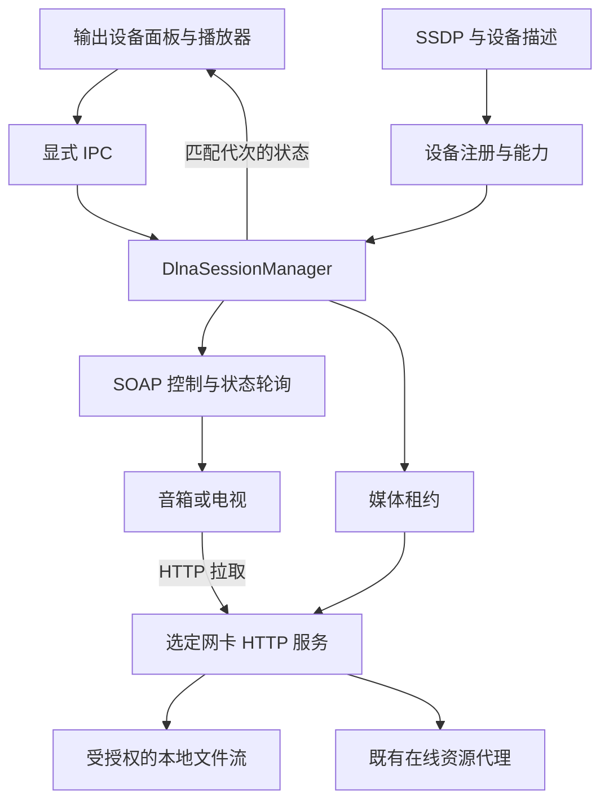

# JJ Music DLNA 音乐投放开发方案

日期：2026-10-29。版本：1.0。状态：方案待评审，未实施、未验证真实设备。

用户已确认目标：把 JJ Music 的本地和在线音乐投放到音箱或电视。本文按此主线设计；新增交互、参数、技术选型和分期为推荐方案，不能当作用户已经逐项确认或产品已经支持。

上游：[产品规则](../../PRODUCT_RULES.md)、[在线可靠性设计](2026-10-15-online-reliability-design.md)、[现有架构](../../ARCHITECTURE.md)。本轮只写方案，不安装依赖、不发现或控制真实设备、不运行真实音源、不改产品代码、不提交推送。

## 1. 功能边界与交付目标

DLNA/UPnP AV 有不同角色，不能仅用一个“支持 DLNA”开关代替范围定义：

| 能力 | JJ Music 的角色 | 本方案范围 |
| --- | --- | --- |
| 将音乐投放给音箱/电视 | Control Point，附带供设备拉取的 HTTP 媒体端点 | 主线，分本地和在线两阶段交付 |
| 浏览 NAS/其他软件共享曲库 | MediaServer 客户端，调用 ContentDirectory | 后续独立项目 |
| 让电视/手机浏览电脑曲库 | 完整 MediaServer，含发现广播与 ContentDirectory | 后续独立项目 |
| 接收手机投放，在电脑播放 | MediaRenderer | 后续独立项目 |

首版为同一局域网 IPv4、一个选定输出设备、应用运行期间由 JJ 管理队列。支持设备发现、选择、本地音乐直传、播放/暂停/停止、设备状态、受支持时的进度与音量；第二阶段接入在线音乐和混合队列。

不包含 AirPlay、Chromecast、蓝牙、多房间同步、远程互联网播放、设备端永久队列、后台系统服务、自动转码、系统声音采集。仅支持“浏览媒体”的电视不一定具备可受控的 MediaRenderer；没有 AVTransport 控制能力时明确不支持投放，不能只因发现设备就列为可播。

## 2. 网上成熟案例与取舍

调研日期：2026-10-29。只引用项目官方资料；以下是能力与架构参考，不构成本项目互操作或性能实测。来源链接见第 15 节。

| 案例 | 官方资料可确认的做法 | 本项目借鉴与限制 |
| --- | --- | --- |
| foobar2000 `foo_upnp` / Platinum | 将 Renderer、Server、Control Point 分开，并有按设备调整流格式的能力 | 角色分离、设备能力适配；组件页面仍标历史 Windows 32 位版本，不直接嵌入或当作当前 Electron 依赖 |
| Jellyfin 官方 DLNA 插件 | 将 DLNA 做成独立插件，说明局域网 SSDP 与部署网络条件 | 主进程独立服务和明确网络诊断；其 C# 服务端栈不直接移植，GPL-3.0 源码不直接复制进当前 MIT 项目 |
| `pulseaudio-dlna` | 通过流服务输出音频，处理网络地址选择、设备差异及 Range 兼容 | 重视 HTTP 和真实设备配置；其 Linux/PulseAudio/编码流程不是 Windows Electron 的直接方案 |
| `upnp-mediarenderer-client` | Node 控制设备，示例含载入、播放、暂停、停止、定位和音量 | 作为控制流程与模拟交互参考；已查包描述依赖老式 CJS/elementtree，且测试脚本为占位，不能直接认为已满足本项目取消、边界和测试要求 |

技术选择比较：

1. 整套接入 Platinum 等原生 SDK：覆盖角色多，但增加原生构建、绑定与许可证评估；本轮功能范围不需要。
2. 原样接入旧 Node 控制库：起步快，但需补协议边界、测试、取消及网络约束；维护收益未必高。
3. 推荐：Node 标准 `dgram/http` 做有限范围的发现和媒体服务，以小型 TypeScript 适配层实现所需 SOAP 控制，复用成熟案例流程和协议，使用经过审核的 XML 库。避免重写完整 UPnP 栈。

XML 候选为 `fast-xml-parser`，接入前锁定实际版本、核查许可证与已知问题，验证 DTD/实体关闭和大小深度限制；不安装未经验证的“全能 DLNA 插件”。GENA 事件订阅放后续阶段，首版使用有界轮询，减少回调端口和订阅续期复杂度。

## 3. 项目实际情况与改动入口

基线：当前 `package.json` 为 0.6.0，Electron + Vue 3 + Pinia + TypeScript，已有 Windows 原生音源启动构建入口。本轮 Git 状态检查未发现待处理文件，但实施前仍须重新检查。

| 现有能力 | 已核对入口 | DLNA 影响 |
| --- | --- | --- |
| 统一音频接口 | `src/shared/audio-engine.ts` | 可接远程适配器，但需增加远程输出与可选控制能力，不能假定所有引擎都有本地频谱 |
| WebAudio 与双通道过渡 | `src/renderer/src/audio/web-audio-engine.ts`、交叉渐变控制器 | 远程原始资源拉取不会经过本地音效；DLNA 下明确关闭这些能力，不改用户本地偏好 |
| 播放队列与收集 | `src/renderer/src/stores/player.ts`，目前 `ensureEngine()` 直接创建 WebAudioEngine | 引入输出选择/工厂和远程事件，保留队列、原条目身份及播放代次 |
| 本地媒体与范围读取 | `src/main/media/media-response.ts` | 复用路径授权、GET/HEAD、Range 与文件释放；现有 `jjmedia://` 不能给电视直接访问 |
| 在线媒体代理 | `src/main/online/source-media-proxy.ts` | 复用上游公开 URL 校验、源版本、取消与流限制；`jjstream://` 需映射为新的 LAN HTTP 租约 |
| IPC 边界 | `src/preload/index.ts`、`src/shared/ipc.ts`、主进程装配处 | 设备和网络只在主进程，页面只提交设备 ID 和业务资源引用 |
| 公网请求防护 | `src/main/online/url-guard.ts` | 现有公网校验拒绝私网，应新增专用 LAN 客户端，不全局放开公网 guard |

本方案不撤回任何已实现播放规则，也不因投放把已收藏的在线条目改成本地条目。

## 4. 固定要求

- DN-01：投放保持原条目身份、本地/在线独立、音质优先和同版本约束。
- DN-02：设备必须能访问真实 LAN HTTP 资源；禁止发送 `localhost`、文件路径、`jjmedia://` 或 `jjstream://` 给设备。
- DN-03：电脑与远程输出互斥；切换失败不自动让另一端发声，设备失联不自动本机续播。
- DN-04：发出 Play、HTTP 拉取或 SOAP 成功均不单独等于播放成功；只在确认当前远程资源播放后触发收集。
- DN-05：控制、轮询、媒体流按会话/播放代次取消；迟到结果不覆盖新歌曲或新设备。
- DN-06：能力驱动 UI，不承诺设备端交叉渐变、EQ、频谱、精确定位或位完美输出。
- DN-07：LAN 发现和控制是专用信任域，不削弱原有公网和音源保护；不开放整个曲库或任意 URL 代理。
- DN-08：停止、切歌、停用音源、变更网络、应用退出须回收媒体租约、连接和轮询。
- DN-09：解码不支持时明确失败；自动降低在线解析档位与转码是不同决定，不伪装无损。
- DN-10：真实兼容按设备型号/固件与格式记录，模拟通过不代表所有“DLNA 设备”可用。

## 5. 模块架构与职责

新增建议文件：

| 文件 | 职责 |
| --- | --- |
| `src/shared/dlna.ts` | 设备、能力、会话、资源引用和错误的序列化类型 |
| `src/main/dlna/discovery.ts` | 指定网卡 SSDP 搜索、去重、TTL 过期 |
| `src/main/dlna/device-registry.ts` | 描述/SCPD、UDN 身份、能力与设备配置 |
| `src/main/dlna/lan-http-client.ts` | 受限定 LAN 设备请求、地址固定及响应限制 |
| `src/main/dlna/soap-client.ts` | SOAP 参数编码、动作与错误归一化 |
| `src/main/dlna/media-server.ts` | 仅租约资源的 HTTP 读取和流回收 |
| `src/main/dlna/media-lease.ts` | 原资源引用、设备、版本和会话绑定 |
| `src/main/dlna/session-manager.ts` | 控制顺序、状态、代次、轮询与生命周期 |
| `src/renderer/src/audio/dlna-engine.ts` | AudioEngine 的远程桥接，不在 renderer 开网络 |
| `src/renderer/src/components/OutputDevicePicker.vue` | 本机/设备选择、发现与能力提示 |

具体实现避免在 `index.ts` 或 player store 中塞入完整协议；装配、行为和传输分开。主进程保管网络会话和流，renderer 继续管理现有队列，首版不另建第二套完整队列服务；应用或 renderer 无法继续协调时停止并标记会话失效。

## 6. 发现、网络和设备能力

DLNA 默认关闭，用户打开设备面板并启用后才联网发现；不启动时扫描全网，不持久自动连接并发声。

首版选一个用户可确认的非回环物理 IPv4 网卡，向 `239.255.255.250:1900` 发送 M-SEARCH，搜索 MediaRenderer，识别兼容的服务版本。可以用临时本地 UDP 端口接收单播搜索响应，不要求独占绑定 UDP 1900；NOTIFY 常驻监听作为后续增强，端口被其他软件使用不能造成应用整体失败。

推荐一轮搜索 6 秒、最多发送两次请求，描述获取并发 4、单设备 3 秒、最多保留 64 个设备。UDN 是主身份，名称不能作为唯一键；地址变化需重新验证，设备缓存只用于展示，不直接控制旧地址。TTL 优先使用合法 `max-age`，无可靠 TTL 时 120 秒标记过期。

描述设备类型、AVTransport、RenderingControl、ConnectionManager 与服务 SCPD 后确定能力。控制版本按实际 serviceType 生成 SOAPAction，不硬编码所有设备为 v1。首版支持常见实例 0；需要 `PrepareForConnection` 才能工作的设备另入兼容任务，不能假定所有 ConnectionID 都等于 0。

必需动作：SetAVTransportURI、Play、Stop、GetTransportInfo、GetPositionInfo，并需可识别当前媒体。Pause、Seek、音量和静音按服务实际支持展示。GetProtocolInfo 的 Sink 是格式协商依据之一，不能当作实际播放保证；设备声明通配或缺失时仅对已通过样本的格式尝试。

HTTP 服务只绑定选定网卡地址和系统分配端口，对外 URL 使用到设备可达的该地址。多网卡/VPN 不默认选第一个地址，面板显示当前网卡并允许切换；变更后重建会话和 URL。防火墙被阻止时给私有网络提示和重试，不静默提权、创建全网放行规则或进行路由器端口映射。

## 7. SOAP 控制与状态模型

每会话有 `sessionId`，每首有 `generation` 和 `resourceId`。建议状态：idle、discovering、connecting、loading、playing、paused、stopping、disconnected、error。事件带版本序号，UI 忽略过期事件。

协议基础：AVTransport 控制播放与位置；RenderingControl 控制设备音量/静音；ConnectionManager 查询接收格式。SetAVTransportURI 携带正确转义的 DIDL-Lite 音乐元数据和资源 URL，MIME/protocolInfo 依据实际内容生成，不用文件扩展名伪造编码。

控制请求单设备串行；轮询不覆盖待确认的较新命令。推荐 SOAP 单请求超时 4 秒，选定设备后控制加载阶段总预算 15 秒；在线解析仍使用原有预算，并向用户分别显示解析/设备加载。状态查询可在余量内重试一次，Play/Seek/SetURI 等不盲目自动重发，应先核对设备当前状态。

播放时每 1 秒、暂停时每 5 秒轮询，任一设备至多一个在途轮询，连续 3 次失败标记 disconnected 并暂停队列推进。首版不实现 GENA，后续接入订阅仍需保留轮询恢复和 SID/SEQ 校验。

### 7.1 开始与输出切换

用户选设备后先验证设备能力和媒体可用性，再暂停本机并取消本机预加载/交叉渐变，发送 URI 和 Play。远程确认前保持 loading，不播放本机试听音，不调整设备到最大音量。切换期间所有旧本机事件失效。

当前曲目切过去时，仅在设备明确支持且实测可靠时按原进度 Seek；否则提示从头开始。失败保留原队列与已知进度，提供重试或返回本机按钮，不自动恢复声音。切回本机应先尝试停止远程，停止未确认时提示“设备可能仍在播放”，由用户明确决定是否继续本机，避免双端发声。

设备的音量与电脑音量独立，初次连接先查询设备音量而非写入本地音量。按 SCPD 范围映射 UI 0–100%，硬件无音量控制则禁用；不把本地静音状态无提示地覆盖整个电视。

### 7.2 播放确认、收集与结束

确认至少满足：状态为 PLAYING，且设备报告的 CurrentTrackURI/AVTransportURI 匹配本次租约，并有播放位置推进或当前租约实际音频数据传输的佐证。HEAD、预取、Play 返回成功均不足以单独确认。设备报告 URI 异常的例外只能在针对型号的验证后加入配置，不能全局放宽。

不能可靠确认的设备先标为受限/不兼容，不提前写收集箱。确认后仅发出一次本代次 playing，收集原在线条目；本地歌曲仍不收集。设备回报不能证明真实音质或声学输出，界面保持“解析档位/规格未检测”的区分。

STOPPED 可能来自遥控器停止、他人接管或加载失败，不可直接发 ended。只有当前 URI、此前确已播放、进度/已知时长及设备验证规则共同支持自然结束时才推进队列；无法判断时停止等待用户，不自动跳曲。结束推进按代次一次性提交。

如果当前 URI 被其他控制器替换，标记会话被接管，停止轮询控制与队列推进，不向不再属于本会话的节目发送 Stop。暂停/拖动/换歌等遥控操作能识别时更新 UI；不假装拥有设备端完整队列。

## 8. 本地媒体 HTTP 服务

设备主动拉取电脑提供的 URL，不是电脑通过 SOAP 上传音频。只暴露形如 `/dlna/media/<随机租约>/audio` 的资源，不公开文件路径、不提供目录列表或任意路径参数。

本地资源引用 `{kind:'local', trackId}` 由主进程查曲库并调用现有 realpath 授权检查；每次读取重新校验可用性和授权。可复用 `serveMedia` 内部响应，但需桥接 Node HTTP 与 Web Response 的状态、头、背压和取消，不直接暴露自定义协议处理器。

支持 GET、HEAD、单 Range、206、416、Content-Length、Content-Range、Accept-Ranges；错误状态真实返回，不能把整文件 200 假报为 206。DLNA `contentFeatures.dlna.org` 和 transferMode 根据真实传输能力产生，不伪造 DLNA profile 标识或时间定位能力。封面为另一个有界租约路由，可选且不影响音频播放。

随机 token 至少 192 位，绑定设备 IP、网卡、会话、代次与资源。当前播放/暂停保持租约，播放超过 15 分钟不因固定 token TTL 失效；切歌/停止立即撤销并关闭旧连接。闲置超过 30 分钟可提示并结束暂停会话，不在无提示情况下永久共享文件。

首版一活动设备，最多 4 条媒体读取连接，超出返回可解释状态；流式发送，不整文件入内存。原文件修改或删除需要现有文件释放机制协作：不要让 LAN 读取绕过标签写入/下载删除的句柄回收。资源失效要向 session-manager 报告，不继续复用旧文件身份。

## 9. 在线歌曲、质量与设备格式

沿用在线解析器的原平台/同版本/目标档优先顺序，原条目不变。主进程只接受本应用已经签发、仍属于当前音源版本的媒体资源引用，不允许 renderer 或设备请求任意公网 URL。

首版在线统一通过电脑中转：设备只见 LAN 租约，原地址、请求头和音源信息留在主进程，沿用现有公网 DNS/重定向校验和有界代理。不能把公网 guard 改成“允许所有私网”来方便 DLNA。

首版仅支持可直接读取的渐进式 HTTP 音频；HLS/DASH、DRM 或依赖浏览器解密的流不按普通文件投放。未知长度、上游读取上限和响应超时按现有代理约束处理，不为投放全局放宽；需要这些格式时独立设计清单转发、解码与设备能力，不能假报支持。

现有在线代理 token 有限期，不能把它直接塞进长时间有效的 LAN token。需要新增受控的活动租约/引用保留机制：底层资源在当前会话有效期间可用，但源版本变化、停用和原地址失效仍立即生效；租约释放后恢复普通缓存回收。仅重复延长外层 token 不解决内层过期。

Range、ETag、长度与上游表示保持一致。上游不支持 Range 时不能假装支持拖动；禁用远程 Seek 或明确限制。断流后重新解析 URL 只有确认同一表示/版本才允许恢复同一字节范围；不能把新解析的不同音质/不同文件字节拼到旧流中。无法确认时结束本次载入，重新 SetURI 并提示恢复限制，重试仍共享原预算。

格式策略：本地 MP3 作为首个兼容样本，WAV/FLAC/AAC/M4A 按设备能力与真实样本逐项开放；不承诺“本地能解码就都能投”。实际内容信息与设备协议不匹配时明确失败。

设备不支持目标编码时，可以在可证明兼容的在线档位候选中继续已有降档策略，但必须显示设备兼容限制和实际解析档位；不能将转码伪装为音源降档。本地不自动改播在线同曲。首版不带 FFmpeg；后续如需转码，独立评审质量策略、体积、许可证、进程回收、定位与显式提示。

远程直传不经过 WebAudio：EQ、频谱、播放速率、淡入淡出、交叉渐变和独占/位完美声明关闭或显示不适用。本地相关设置保留，切回本机恢复，不能永久覆盖用户偏好。首版不使用 SetNextAVTransportURI，先用可靠单曲控制由 JJ 推进队列，间隙不承诺无缝。

## 10. 局域网边界与生命周期

SSDP、XML、SOAP 都是不可信输入。首版仅选定私有 IPv4 子网设备，拒绝回环、云元数据/link-local、组播 URL、userinfo 和非 HTTP(S) 描述；IPv6 与跨子网设备另行支持。局域网 IP 不是可信服务器身份，不自动执行设备提供代码或下载插件。

发现响应的 LOCATION 必须与响应来源及选定接口关联。相对 controlURL 解析后重新校验；首版仅允许同设备验证 IP，可使用描述声明的端口；跨主机 URL/重定向默认拒绝，确需例外按实机配置评审。连接时固定已验证地址，限制出站描述、SCPD、SOAP 的目标，不把公网抓取防护直接复用成一个宽松开关。

XML 禁用 DTD、外部实体和实体展开；文档上限 512 KiB、最大深度 64、节点数 20000，SOAP 响应同限，SSDP 数据报上限 16 KiB。实现时用可验证限制的解析方案，不能假定所选库默认安全。超限拒绝并记录脱敏错误。

媒体 token 按来源 IP 校验；同一设备若使用不同网卡拉流，先验证并配置允许的 IP 集合，不放开为整个子网。请求不接受任意转发头、绝对目标 URL、路径或凭据。LAN HTTP 不加通配 CORS、不提供网络控制 API，页面只能经显式 IPC 控制。

网络为 HTTP 时 token 在该 LAN 可被观察，不能宣称端到端加密或强设备认证；仅建议在可信私有网络启用。无需调整系统全局代理，不作 UPnP IGD 端口映射。

退出应用尽力 Stop 并撤销媒体租约，关闭 HTTP/UDP 与轮询；设备可能已缓冲内容，不能保证瞬间无声。最小化到托盘继续有效，真正退出后不能承诺播放完整队列。renderer 崩溃时主进程停止其会话，不保留无人管理的持续控制。

设备离线、Wi-Fi/VPN/网卡切换时暂停队列推进并提示重新选择，不自动改投另一设备；应用重启只记住设备偏好，不自动发声。用户手工重连产生新代次，不使用旧 URL、状态或租约。

## 11. IPC 与引擎接入契约

建议新增显式 API：`dlna.listDevices()`、`dlna.discover(interfaceId)`、`dlna.connect(deviceId)`、`dlna.load(sessionId, resourceRef, metadata, generation)`、`dlna.command(sessionId, action, args, generation)`、`dlna.disconnect(sessionId)`、`dlna.onState(handler)`。

设备 ID 必须来自主进程注册表；resourceRef 只允许授权本地 ID 或本应用签发的在线 token 引用。请求/返回结构均有运行时验证，页面不能传任意设备 URL、SOAPAction 或 HTTP 头。事件提供取消订阅，窗口销毁撤销所属会话。

AudioEngine 增加输出目标类型与 pause/seek/volume 可用能力，`DlnaEngine` 通过 IPC 适配现有控制方法。当前接口若默认 seek/volume 同步更新，需改为远程确认或明确 pending，不能模拟本地瞬间完成。load 参数从仅 URL 拓展到可识别业务资源引用，保持 WebAudio 分支兼容。

player store 的队列、历史、收藏与收集共用现有逻辑，仅把远程确认事件接进来；输出切换独立于队列替换。音源版本事件同时撤销在线 LAN 租约，旧媒体的错误不能覆盖新播放。

## 12. 开发分期和文件任务

以下是设计层分解。用户评审后再写逐步实现计划，不把整份方案当作一次性大改任务。

| 任务 | 范围 | 前置与交付门槛 |
| --- | --- | --- |
| D0 基线/设备样本 | 核实媒体/引擎/可靠性接口；记录目标音箱/电视型号固件、格式与网络；选XML依赖版本 | 先明确至少一台实际目标设备，保留现有修改；没有设备时只做模拟，不能宣称兼容 |
| D1 发现与协议 | discovery、registry、LAN client、SOAP、XML与能力 | D0；模拟不同服务版本和故障，真实发现由用户显式触发 |
| D2 本地 HTTP | media-server、lease、授权路径与流回收 | D1；MP3 GET/HEAD/Range/取消与LAN访问通过 |
| D3 本地投放闭环 | session-manager、DlnaEngine、输出选择、事件与队列 | D2；真实本地单曲/列表、停止/切换与收集规则通过 |
| D4 在线和混合队列 | 现有解析器/代理活动租约、版本失效、格式约束 | D3；长曲、多次Range、断流恢复不混字节；本地在线交替身份保持 |
| D5 设备兼容与控制 | 音量/Seek、按型号配置、遥控操作、失联恢复 | D4；按实际能力开放，不能确认的结束不自动推进 |
| D6 包与人工验收 | Windows防火墙提示、独立包目录、多网卡、生命周期和回归 | D3–D5；记录支持表、限制及真实听歌结果 |

可先交付 D0–D3 的本地投放，再交付 D4–D6；单个任务的引擎/状态改造不要并行编辑同一 store。GENA、设备端下一曲、转码和其他DLNA角色均须另立设计。

建议测试：新增 `dlna-discovery.test.mts`、`dlna-soap.test.mts`、`dlna-media-server.test.mts`、`dlna-session.test.mts`、`dlna-engine.test.mts`，扩展现有媒体代理、Range、player、音源版本和 IPC 测试；加入现有 `tools/build-test.mjs` 打包入口。模拟设备应能延迟/乱序回包、从HTTP拉取字节、伪造格式声明及中断连接。

交接记录建议在 `docs/development/2026-10-29-dlna/D0.md` 至 `D6.md`，分别记录规则、接口、实际测试、样本、真实设备证据、遗留问题。实施前核实 `npm run verify` 与 `npm run test:e2e`，打包继续既有 `npm run pack` 流程；文档阶段不运行联网探针或产品测试。

## 13. 验收矩阵

| 场景 | 操作与预期 | 规则 | 任务 |
| --- | --- | --- | --- |
| DV01 | 两个同名设备、重复SSDP、设备过期/换IP：按UDN去重并重新验证 | DN-05、DN-10 | D1 |
| DV02 | 只有MediaServer、无AVTransport、缺少可选动作：不假标可投放，能力正确 | DN-06、DN-10 | D1、D5 |
| DV03 | 本地MP3及中文路径，设备GET/HEAD/Range/416：字节和长度一致，无路径泄露 | DN-02、DN-07 | D2 |
| DV04 | 本机播放中切到设备、失败后返回本机：不隐式双端播放，队列不替换 | DN-03 | D3 |
| DV05 | SOAP成功、预取、HEAD、旧URI PLAYING：不提前收集；当前资源确认后仅一次 | DN-01、DN-04 | D3、D4 |
| DV06 | 连点A/B、换设备、SOAP迟到、重复结束：仅当前代次生效 | DN-05 | D3、D5 |
| DV07 | 设备遥控暂停/Stop/他人接管：状态准确，不误判自然结束或停止他人节目 | DN-03、DN-05 | D5 |
| DV08 | 在线目标档失败、同版本换源、设备不支持编码：原身份与档位顺序保留，限制明确 | DN-01、DN-09 | D4 |
| DV09 | 20分钟在线曲暂停后Range重连、源停用/更新：租约不假续期，版本失效可回收 | DN-05、DN-08 | D4 |
| DV10 | 上游忽略Range、URL失效后文件表示变化：不假报206、不拼接不同字节 | DN-02、DN-09 | D4 |
| DV11 | 切换输出：EQ/频谱/交叉渐变不冒充生效，切回本机偏好保留 | DN-06 | D3、D5 |
| DV12 | 恶意LOCATION/controlURL、XML实体/超限、越权路径、无效token/IP：拒绝且不削弱公网防护 | DN-07 | D1、D2 |
| DV13 | Wi-Fi/VPN/网卡变更、防火墙拒绝、设备离线：提示并停止推进，不自动换设备/本机发声 | DN-03、DN-08 | D5、D6 |
| DV14 | 文件删除/标签写入、切歌/退出/renderer崩溃：释放读取和租约，旧源不能继续拉取 | DN-05、DN-08 | D2、D6 |
| DV15 | 仅一台设备可用或只有模拟器通过：如实记录支持范围，不声称全DLNA兼容 | DN-10 | D0、D6 |
| DV16 | 原设备音量与本机音量不同：读取设备值，不自动拉满，能力不支持则禁用 | DN-03、DN-06 | D5 |

自动回归使用假的时钟、UDP/HTTP设备与临时曲库，测试真实生产模块，不只断言 mock 被调用。真实验收建议一台音箱和一台电视；只有其中一种时可有限交付并明确未验证项，不为凑样本要求购买设备。

验收记录至少包含设备型号/固件、网卡、格式/编码、目标与解析档位、模式、SOAP错误、HTTP状态/范围、状态确认与听感。日志不记录租约完整URL、音源原地址或用户绝对文件路径；默认无遥测上传。

## 14. 风险、默认决定与评审重点

主要风险是设备协议实现差异、编码能力误报、HTTP可达性、在线链接有效期，以及STOPPED/PLAYING回报不准确。这些通过能力协商、保守确认、真实样本与明确限制处理，不靠无限重试或隐藏错误。

本版推荐默认：单设备/IPv4、应用运行时管理队列、电脑中转在线音频、不自动转码、不自动恢复发声、不开放整个曲库、轮询优先、远程不启用本地DSP和过渡。设备确认方式、范围和预算随本文评审，不视为已经逐项批准。

下一步先评审 D0–D3 本地投放边界和目标设备，再形成详细实现计划；在线投放仍列为明确后续阶段，不因本地试播成功就标记整个方案完成。

## 15. 官方来源与研究边界

- [foobar2000 UPnP 组件](https://www.foobar2000.org/components/view/foo_upnp)：多角色与设备格式适配；页面标明历史版本和平台限制。
- [Platinum 项目](https://github.com/plutinosoft/Platinum)：原生 UPnP SDK 参考；不直接作为已选依赖。
- [Jellyfin DLNA 文档](https://jellyfin.org/docs/general/post-install/networking/dlna/)及[官方插件](https://github.com/jellyfin/jellyfin-plugin-dlna)：独立模块和网络部署参考；文档的服务端端口要求不直接等同本方案只发搜索的客户端绑定策略。
- [pulseaudio-dlna](https://github.com/masmu/pulseaudio-dlna)：HTTP流和设备差异经验，Linux系统方案不直接移植。
- [Node MediaRenderer 客户端](https://github.com/thibauts/node-upnp-mediarenderer-client)及[包描述](https://raw.githubusercontent.com/thibauts/node-upnp-mediarenderer-client/master/package.json)：控制流程参考与依赖/测试现状。
- [AVTransport:1](https://upnp.org/specs/av/UPnP-av-AVTransport-v1-Service.pdf)、[ConnectionManager:1](https://upnp.org/specs/av/UPnP-av-ConnectionManager-v1-Service.pdf)：动作、状态和格式协商基础；实现依据设备实际服务版本与SCPD，不宣称DLNA认证。
- [fast-xml-parser](https://github.com/NaturalIntelligence/fast-xml-parser)：XML候选，实际版本、安全配置与限制在D0验证，未安装。
